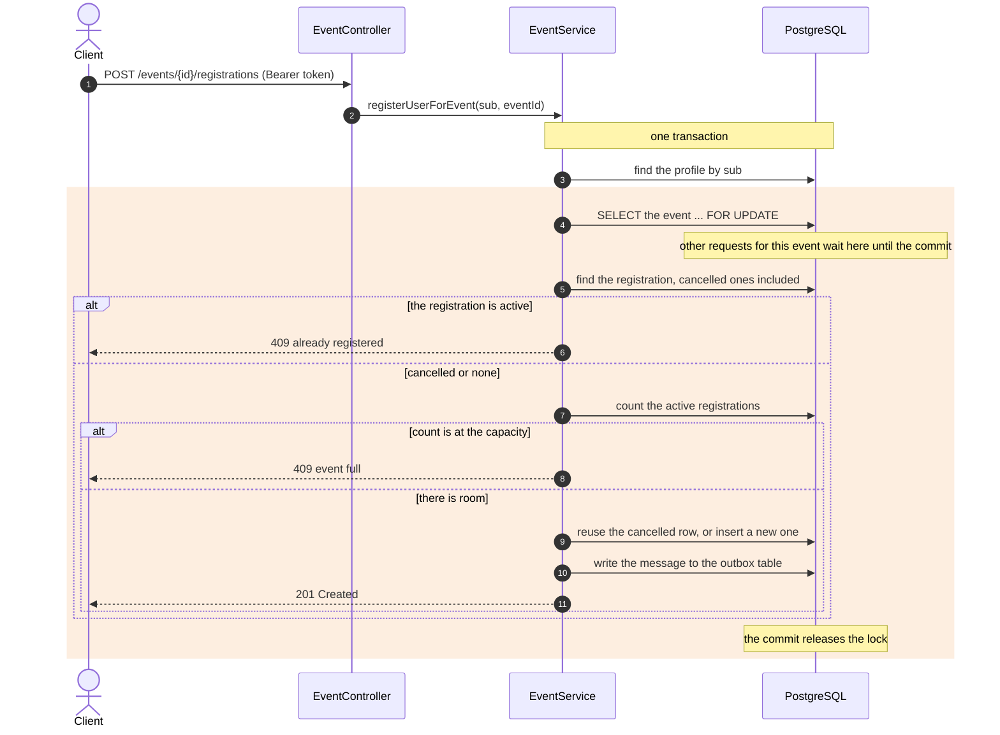
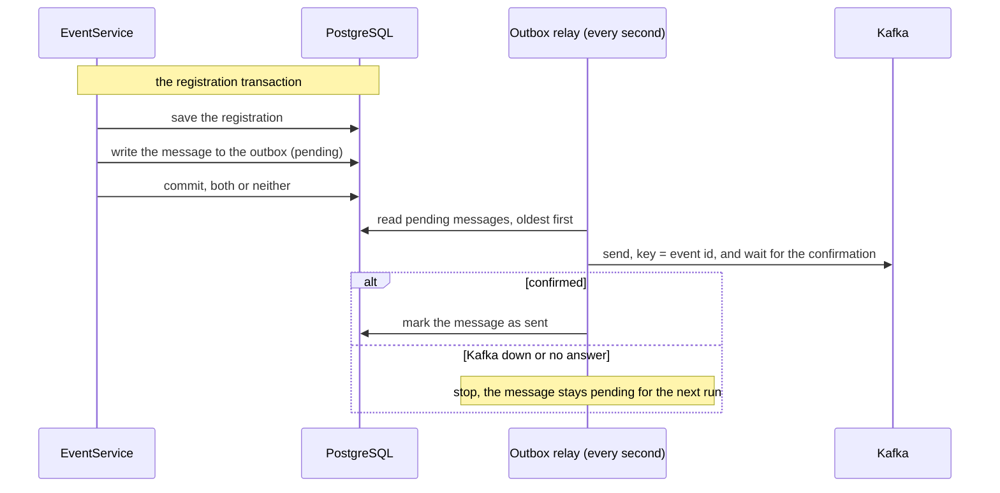
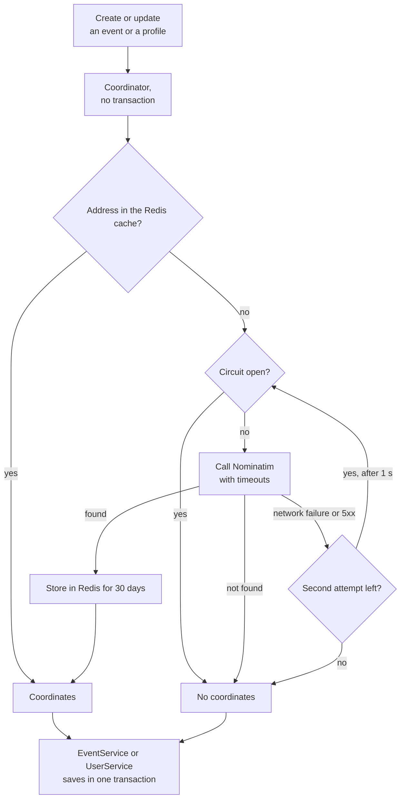

# Architecture

How Events Manager API is built and why. The [README](README.md) says what it does; [RUNNING.md](RUNNING.md) says how to run it.

- [Overview](#overview)
- [How a registration works](#how-a-registration-works)
- [How a registration reaches Kafka](#how-a-registration-reaches-kafka)
- [How an address gets its coordinates](#how-an-address-gets-its-coordinates)
- [Security](#security)
- [Deployment](#deployment)
- [Testing strategy](#testing-strategy)
- [Decisions and trade-offs](#decisions-and-trade-offs)
- [What went wrong along the way](#what-went-wrong-along-the-way)
- [Known gaps](#known-gaps)

## Overview

- **Request path:** Route 53 and an Application Load Balancer (HTTPS) in front of one EC2 host. The host runs the API, PostgreSQL 16, Redis 7.4, one Kafka broker and the notification service with Docker Compose.
- **Sign-in:** Amazon Cognito issues the tokens. The API only validates them with the pool's public keys and never sees a password.
- **Cache:** Redis keeps each page of the event listing for 30 seconds and each geocoded address for 30 days. If Redis fails, the API falls back to PostgreSQL.
- **Geocoding:** the API calls Nominatim to turn an address into coordinates.
- **Messaging:** every registration and cancellation becomes a message on a Kafka topic. The notification service, in [its own repository](https://github.com/willianfaes/events-notification-service), reads it.
- **Deploy:** every merge to `main` builds and tests, publishes an image tagged with the commit SHA to ECR and starts the deploy on the host through Systems Manager Run Command (no SSH port).
- **Metrics:** the API exposes them on a separate port. Prometheus and Grafana (latency percentiles, cache hit ratio, a p95 alert) run with Docker Compose locally, not on the host, to save its memory.

The code is organized by feature (`events`, `users`, `auth`, `common`), each with its own controller, service, repository, entities, DTOs and mappers.

## How a registration works

`POST /events/{id}/registrations` is the route the capacity rule protects. The whole call runs in one transaction, and the event row is locked first, so concurrent requests for the same event are served one at a time.

A missing profile or event answers `404`. Three choices make it safe:

- **Lock, then count:** the count is read only after the lock, so two requests can never both see the last free spot. Only requests for the same event wait; other events are not affected.
- **"Already registered" before "event full":** a user who is already in gets the accurate error even when the event has just filled up.
- **A cancelled registration is reused, not duplicated:** `event_registrations` has `UNIQUE (user_id, event_id)`, so a user who cancels and registers again gets the same row back.

The concurrency integration test and the k6 race exercise exactly this path: 200 users race for 50 spots, and exactly 50 get `201` while 150 get `409`.

Cancelling needs no lock: it is one conditional `UPDATE` (`... AND is_deleted = false`), so of two concurrent cancels only one changes the row and sends a message; the other gets `404`.

## How a registration reaches Kafka

Registering and cancelling publish a message to the `registration-events` topic, so other services can react without the API knowing them. Sending to Kafka inside the request would have two failure modes: a message for a registration that then rolls back, or a registration whose message is lost because Kafka was down. So the API writes the message to an **outbox table in the same transaction**, and a job sends it afterwards.

- **Nothing is lost, nothing is sent for a rollback:** the message exists only if the registration committed, and it stays in the table until Kafka confirms it. A request never waits for Kafka, so Kafka being down never blocks a registration.
- **At least once:** if the app stops after Kafka confirms but before the row is marked, the message is sent again. Each message carries a unique `messageId` so a consumer can ignore a repeat.
- **Order per event:** the event id is the key, so the messages of one event land in the same partition, in order. The job stops at the first failure, so a later message never overtakes an earlier one.
- **The message has no e-mail:** it carries the user's Cognito `sub`.
- **Kept forever:** the topic has no retention limit, so a consumer can go back to the first message and rebuild its state.
- **Why Kafka:** the topic keeps every message, so a consumer can replay it, and each consumer group reads it independently. A queue such as RabbitMQ deletes a message once it is consumed. At this volume either would work.

### The notification service

A separate Spring Boot service reads the topic with two consumer groups, so each one gets every message whatever the other does:

- **`notification`** logs a fake confirmation or cancellation e-mail. A repeated message sends it again, which is acceptable for a notification.
- **`statistics`** keeps a count per event. It records each `messageId` in the same transaction as the count, so a repeated message changes nothing.

While its database is down, the consumer waits and retries until it is back. Any other failure is retried twice, then the message goes to the `registration-events-dlt` dead letter topic and the consumer moves on.

On the deployed stack, a registration reached both consumers within about a second.

## How an address gets its coordinates

Creating or updating an event or a profile turns an address into coordinates through [Nominatim](https://nominatim.org). It is the only external call in the API, so a provider that is slow or down must not break the request.

- **The call runs before the transaction:** a slow provider never holds a database connection or the lock of the event. A separate bean does this, because a call between methods of the same class would skip the proxy that opens the transaction.
- **Coordinates are optional:** when the call fails, a new event or profile is saved without them. An update keeps the old ones if the geocoded fields did not change, and clears them otherwise, since they would point to the wrong place.
- **Retry only what can recover:** a network failure or a `5xx` gets one more attempt; a `4xx` or an unknown address does not.
- **The circuit breaker stops the calls when the provider is down:** with half of the last 5 attempts failing, it opens for 60 seconds.
- **The street of a profile never leaves the API:** a profile sends only the postal code, the city and the country.

`GET /events?maxDistanceKm=200` returns the events up to 200 km from the profile's address. The Haversine distance is computed in the query, because pagination happens there: filtering afterwards in Java would leave pages with holes and a wrong total. Java computes the `distanceKm` shown again from the same coordinates, and a test keeps the two formulas in agreement. This listing is not cached, since the answer depends on who asks.

## Security

- **Cognito owns identity.** Sign-in, passwords and e-mail verification live in the Cognito user pool. The API is an OAuth2 resource server: it checks the token's signature, issuer and expiry, accepts only access tokens (Cognito signs the ID token with the same keys), and reads two things from it, the `sub` and the `cognito:groups`.
- **The `sub` is the identity.** A profile (name, age, address) is linked to it with `POST /users/me`. The API stores no e-mail and no password.
- **Two roles.** The `USER` and `ADMIN` groups become `ROLE_USER` and `ROLE_ADMIN`; unknown groups are ignored. Everything under `/admin` needs `ADMIN`, checked twice: by URL in the security configuration and by `@PreAuthorize` on the controller.
- **Stateless.** No session, no CSRF token, every request carries its token.
- **Actuator stays inside.** Only `health` and `prometheus` are exposed, on a management port that is not reachable from outside the host.
- **Errors reveal nothing internal.** Every error, including the 401 and 403 raised by the security filters, answers the same JSON body; an unexpected error answers a generic `500` and is the only one logged with its stack trace.
- **The demo account is public, so it cannot be changed.** Its password is in the README. The Swagger app client signs in only through Cognito's login page, because a password sent straight to the Cognito API returns a token that can change that password or delete the user, and `PUT /users/me` answers `403` for the demo profile ([#209](https://github.com/willianfaes/events-manager-api/pull/209)).
- **It used to have its own login.** The move to Cognito took three PRs: accept Cognito tokens ([#157](https://github.com/willianfaes/events-manager-api/pull/157)), link the profile to the `sub` instead of an e-mail ([#158](https://github.com/willianfaes/events-manager-api/pull/158)), then remove the local login and its columns ([#159](https://github.com/willianfaes/events-manager-api/pull/159)).

Who may call each route is tested in one place, `SecurityAccessRulesWebSliceTest`: one row per route, with `401` without a valid token and `403` without the role.

## Deployment

### From merge to production

1. A merge to `main` runs the build and all the tests in GitHub Actions.
2. If they pass, the pipeline builds the image and publishes it to ECR, tagged with the commit SHA. A tag is never overwritten. The pipeline signs in with the access key of a dedicated IAM user. OIDC would be better (no long-lived key), but the account's organization policy blocks it.
3. It sends the compose file and the deploy script to the host and runs the script through Systems Manager Run Command, so the host has no SSH port.
4. The script reads the secrets from Parameter Store, writes the host's `.env`, pulls the image and starts the stack with `docker compose up --wait`. Each repository deploys only its own service and keeps the other one's image.
5. On start, Flyway applies any new migration before the API accepts traffic.

The host never clones the repository: it only pulls images, built from a commit that passed the tests. The AWS resources are Terraform in `infra/`, with the state in S3. The secrets and the CI key are created by hand, so they never reach the Terraform state.

### Why one EC2

Everything runs on one host to keep the demo inside the free plan. The cost of that choice: if the host goes down, the whole system goes down, and the services share its memory (hence the limits below). If this had real users, the first changes would be, in order:

1. **PostgreSQL on a managed database (RDS).** Data is the one thing that cannot be lost; backups and failover stop being my job.
2. **A second API instance, on another host, behind the load balancer that already exists.** One host going down, or a deploy, no longer takes the API down. The API keeps no state of its own: the token is validated on every request, the cache is in Redis and the registration lock is in PostgreSQL, so two instances still never exceed capacity. The outbox relay is the exception, see [Known gaps](#known-gaps).

### Memory limits

Five services share one host, so each container gets a memory limit. If one of them runs out, only that one restarts; without limits, the kernel picks what to kill, and it could be the API.

I didn't guess the numbers, I measured them:

- **Same setup as production:** the full stack ran locally with the same images, each JVM capped as if it were on the t3.medium.
- **Real load:** the k6 test, with 200 users racing for 50 spots plus 50 listings per second for 2 minutes.
- **The rule:** each limit is about 1.4 times the peak the service reached, and the JVM heap gets about 60% of it (the rest is threads and native memory). Kafka's default heap of 1 GB was more than it needed, so it went down to 512 MB.
- **The proof:** I ran the test again with the limits on. Nothing was killed, every message reached the consumer, and the whole stack peaked at 1.6 GB of the host's 3.8 GB.

## Testing strategy

The tests are split by what each kind proves, so a failure points to the layer that broke.

| Kind         | What it proves                                                                                                                                                                       | Example                                                                        |
|--------------|--------------------------------------------------------------------------------------------------------------------------------------------------------------------------------------|--------------------------------------------------------------------------------|
| Unit         | Business rules with mocked collaborators, and pure logic such as page clamping and sort mapping                                                                                      | `EventServiceTest`, `PageRequestsTest`                                         |
| Web slice    | Request and response mapping and the shape of each error, without the rest of the application                                                                                        | `EventControllerWebSliceTest`, `GlobalExceptionHandlerWebSliceTest`            |
| Access rules | Who may call each route: `401` without a valid token, `403` without the role. One table, one row per route                                                                           | `SecurityAccessRulesWebSliceTest`                                              |
| Persistence  | Repositories and queries against a real PostgreSQL                                                                                                                                   | `EventRepositoryJpaTest`                                                       |
| Integration  | Whole requests through the application, with PostgreSQL and Redis in Testcontainers                                                                                                  | `EventControllerIntegrationTest`                                               |
| Concurrency  | Many requests released at the same instant never exceed the capacity of an event, and two cancels of the same registration cancel it once; repeated, because races are probabilistic | `EventRegistrationConcurrencyIntegrationTest`                                  |
| Cache        | The listing is served from Redis without a database query, and falls back to PostgreSQL while Redis is paused                                                                        | `EventListingCacheIntegrationTest`, `EventListingCacheFallbackIntegrationTest` |
| Resilience   | Retry, fallback and the circuit breaker opening and closing, against a fake provider in WireMock                                                                                     | `NominatimClientResilienceIntegrationTest`                                     |
| Messaging    | A registration through the API ends as a message on a real Kafka broker, with the expected key and content                                                                           | `RegistrationOutboxIntegrationTest`, `OutboxRelayTest`                         |
| Conventions  | The suite's own rules, checked with ArchUnit: every repository test extends `AbstractJpaTest`, so they share one context                                                             | `TestConventionsArchTest`                                                      |

CI runs all of them, containers included, on every pull request, in about two minutes.

**Mutation testing (PIT).** Line coverage shows that a line ran, not that a test would notice if it broke. PIT changes the code (flips a condition, removes a call) and reruns the unit tests; a change that no test catches points to a weak test. It runs on demand, not in CI. Example: it showed that no test checked which user and event a new registration is saved with, which is fixed in [#196](https://github.com/willianfaes/events-manager-api/pull/196).

## Decisions and trade-offs

| Chose | Over | Because |
| :- | :- | :- |
| A pessimistic lock on the event row | Optimistic locking (`@Version`) | Registering does not change the event row, so a version on it would never conflict. |
| An outbox table and a relay | Sending to Kafka inside the request | A rollback would leave a message for nothing, and Kafka down would lose one or block the request. |
| Cognito | Keycloak, or a login inside the API | Managed: no server to run, and passwords, e-mail verification and token signing are not the API's job. |
| Flyway migrations, with Hibernate only validating | Letting Hibernate create the schema | The schema is versioned and reviewed like code; a mismatch fails at startup, not in production data. |
| A 30-second cache with no eviction on registration | Evicting on every registration | The listing is read far more than it changes; registering stays the source of truth and answers `409`. |
| Two migrations to move users to Cognito (expand, then contract) | One migration that changes everything at once | Each step can deploy on its own, and the old columns go only after nothing uses them. |
| One EC2 with Docker Compose | ECS or Kubernetes | Cost and size: one host is enough for a demo. See [Why one EC2](#why-one-ec2). |
| Soft delete | Deleting rows | A cancelled registration keeps its history and is reused when the user registers again. |

## What went wrong along the way

### Adding a repository test broke another one

- **Symptom:** after one more JPA test class was added, a different test failed with PostgreSQL's `too many clients`.
- **Root cause:** each JPA test class registered the database in its own `@DynamicPropertySource` method. Spring saw a different configuration per class and built a new context for each, with its own connection pool, and it keeps cached contexts (and their pools) open until the run ends. Together they passed the 100 connections PostgreSQL allows.
- **Fix:** [#186](https://github.com/willianfaes/events-manager-api/pull/186) adds `AbstractJpaTest`, one configuration for every repository test, so they share one context and one pool.
- **Guard:** an [ArchUnit](https://www.archunit.org) rule, `TestConventionsArchTest` ([#203](https://github.com/willianfaes/events-manager-api/pull/203)), fails the build if a `*JpaTest` does not extend it, and also if it finds no `*JpaTest` at all, so a broken rule cannot pass silently.

### Tests that passed without checking the result

- **Symptom:** PIT changed the registration code and no unit test failed. A new registration could be saved without its user and event, and a restored registration could return `null`, with the whole suite green.
- **Root cause:** the test stubbed `save` to accept any registration and checked only the response. In the restore test the mapper was not stubbed, so the mock already returned `null`, the same value as the broken code.
- **Fix:** [#196](https://github.com/willianfaes/events-manager-api/pull/196) captures the saved registration and checks its user and event, and stubs the mapper so the restore test checks what it returns.
- **Guard:** PIT is run on demand (`./mvnw org.pitest:pitest-maven:mutationCoverage`); since [#201](https://github.com/willianfaes/events-manager-api/pull/201) no mutant survives in the services and entity rules.

## Known gaps

- **One host, no backups.** The database lives in a Docker volume on the EC2 host, so destroying the host erases the data. The first fix is a managed database, see [Why one EC2](#why-one-ec2).
- **Kafka is one broker.** One copy of each partition, so it is not fault tolerant; a production setup would use a managed cluster with three copies.
- **Nobody watches the dead letter topic.** A message that lands there stays there; an alert on its size would be the first step.
- **The listing can be a little stale.** The cached listing may show a `remainingSpots` up to 30 seconds old; registering stays the source of truth.
- **Geocoding is synchronous.** It fits an admin form and a sign-up; a higher volume would call for an event after the commit.
- **The outbox is never cleaned.** Sent messages stay in the table; a scheduled job would delete the old ones.
- **The outbox relay assumes one instance.** Two API instances would read the same pending rows and could send a message twice or out of order; the relay needs a lock on the rows it sends before a second instance can run.
- **Monitoring is local.** Prometheus and Grafana are not on the host.
